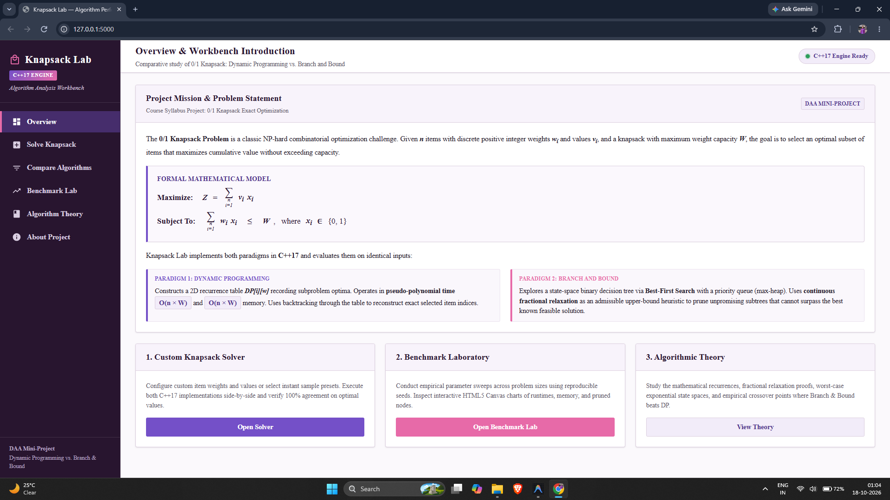
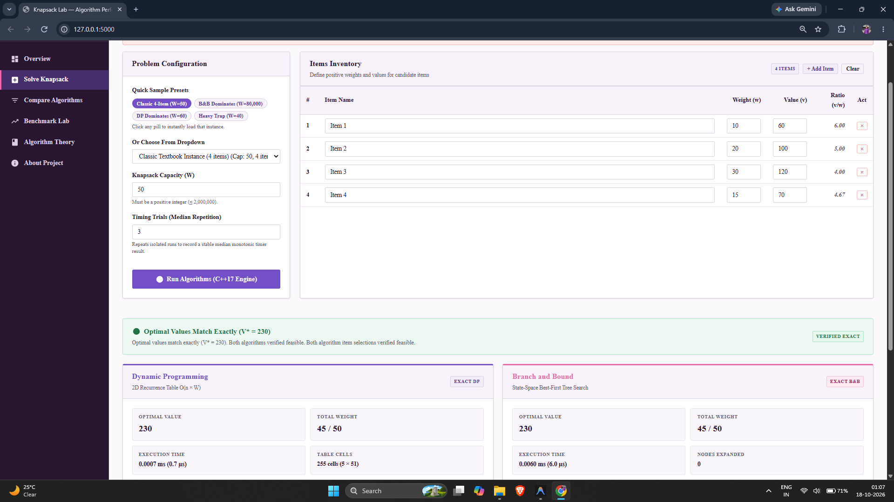
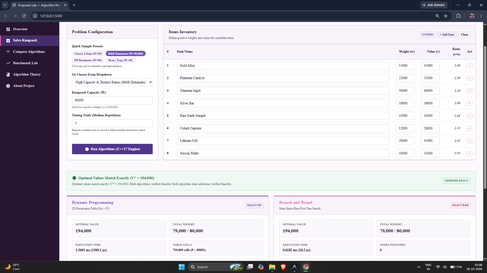
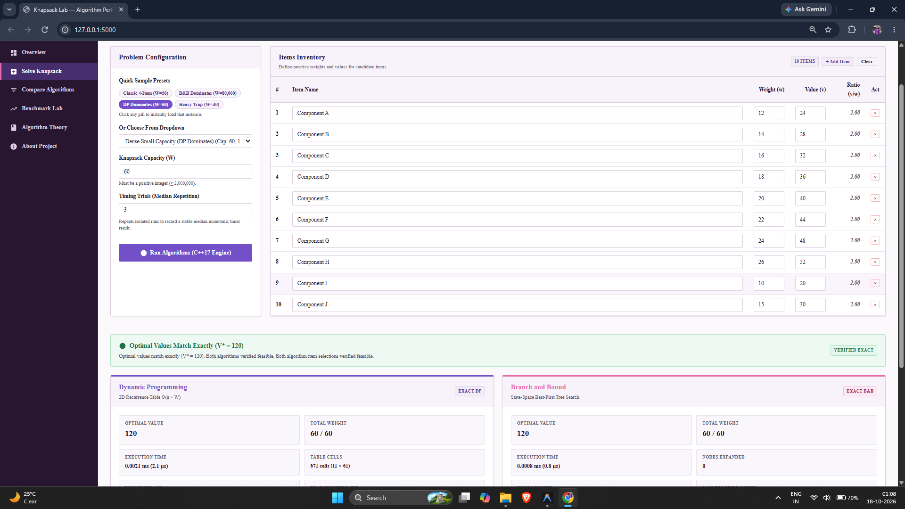
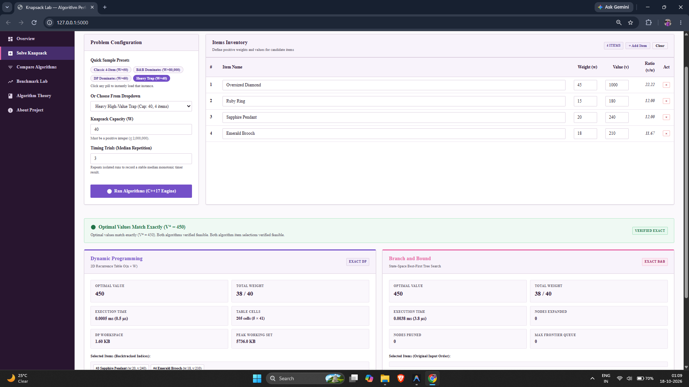
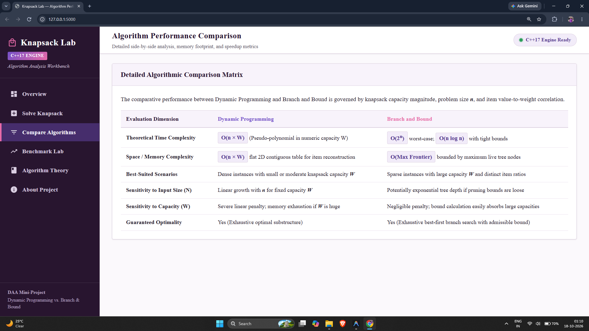
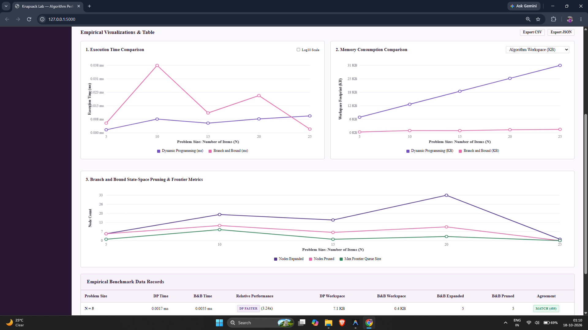

# Knapsack Lab — Algorithm Performance and Comparison Workbench

> **Design and Analysis of Algorithms (DAA) Mini-Project**  
> **Topic:** Solving the 0/1 Knapsack Problem using Dynamic Programming vs. Branch and Bound  
> **Core Implementations:** C++17 (Standard Template Library)  
> **Application Layer:** Python 3 (Flask) + Custom HTML5 / CSS3 / Vanilla JavaScript + HTML5 Canvas API  
> **License:** MIT License  
> **Author:** Shravan Shidruk  

---

## 1. Project Overview & Exact Syllabus Topic

### Exact DAA Course Project Topic
> **"Project: Solving the 0/1 Knapsack Problem using Dynamic Programming vs. Branch and Bound"**  
> **Project Description:** *"Implement the pseudo-polynomial Time Dynamic Programming solution and the state-space tree-based Branch and Bound algorithm (using upper-bound heuristics)."*  
> **Required Analysis:** *"Measure memory consumption and execution time across different input sizes and capacity constraints to observe when Branch and Bound outperforms DP."*

### Application Overview
**Knapsack Lab** is an interactive, professional algorithm workbench designed to implement, cross-validate, and empirically analyze two contrasting exact paradigms for solving the NP-hard **0/1 Knapsack Problem**:
1. **Dynamic Programming (DP):** A pseudo-polynomial time $\mathcal{O}(nW)$ bottom-up tabulation approach with contiguous memory allocation and table backtracking for exact solution reconstruction.
2. **Branch and Bound (B&B):** A state-space tree best-first search algorithm using continuous fractional knapsack relaxation as an admissible upper-bound heuristic with priority queue pruning.

The application executes both algorithms in isolated C++17 child processes on identical datasets, verifies their objective values, checks solution feasibility, measures execution time using sub-microsecond monotonic hardware counters, tracks peak operating system memory consumption, and visualizes empirical benchmarks using interactive HTML5 Canvas charts.

---

## 2. Problem Statement & Mathematical Formulation

Given $n$ items, each having a positive integer weight $w_i \in \mathbb{Z}^+$ and a positive integer value $v_i \in \mathbb{Z}^+$, and a knapsack with a positive integer capacity $W \in \mathbb{Z}^+$, select a binary decision vector $x = (x_1, x_2, \dots, x_n) \in \{0, 1\}^n$ that maximizes total value without exceeding capacity.

### Formal Mathematical Model
$$\text{Maximize } Z = \sum_{i=1}^n v_i x_i$$

$$\text{Subject to } \sum_{i=1}^n w_i x_i \le W, \quad \text{where } x_i \in \{0, 1\} \quad \forall i \in \{1, \dots, n\}$$

Each item can either be taken completely ($x_i = 1$) or left behind ($x_i = 0$). Fractional selections are not permitted in the final solution.

---

## 3. Project Objectives

- **Algorithm Correctness:** Guarantee that both algorithms output identical optimal values ($V^*_{\text{DP}} == V^*_{\text{BB}}$) for identical valid inputs.
- **Feasibility Verification:** Independently confirm that every selected item index is unique, total selected weight does not exceed capacity, and reported value matches the sum of selected item values.
- **Sub-Microsecond Monotonic Timing:** Measure core algorithm execution inside C++17 using hardware counters (`QueryPerformanceCounter` on Windows / `std::chrono::steady_clock` on POSIX), explicitly excluding JSON parsing, IPC, and frontend rendering.
- **Process Memory Isolation:** Execute each algorithm in a dedicated child process to prevent memory contamination and record genuine OS peak working set (`GetProcessMemoryInfo` on Windows / `getrusage` on Linux/macOS) alongside theoretical algorithm workspace footprints.
- **Empirical Boundary Analysis:** Systematically observe and document when Branch and Bound outperforms Dynamic Programming (specifically on instances with large capacities and distinct value-to-weight ratios), and when Dynamic Programming outperforms Branch and Bound.
- **Zero-Dependency Academic Visual Interface:** Provide a desktop-optimized (1920×1080) interface with a refined purple-and-pink aesthetic, Times New Roman typography, responsive layout, and custom Canvas charts.

---

## 4. Screenshots & Application Outputs

All screenshots below represent actual outputs captured from the running application.

### 4.1 Overview & Workbench Introduction

*Figure 1: Overview page displaying the formal mathematical model, problem statement, core algorithmic paradigms (Dynamic Programming vs. Branch and Bound), and quick navigation cards.*

---

### 4.2 Custom Knapsack Solver — Classic 4-Item Instance

*Figure 2: Custom Knapsack Solver executing the classic 4-item Cormen/CLRS textbook instance ($W = 50$). Both Dynamic Programming and Branch and Bound arrive at the exact optimum ($V^* = 230$, $W = 45/50$), with agreement verified and selected items highlighted.*

---

### 4.3 High Capacity Instance — Branch and Bound Dominance

*Figure 3: Instance with large capacity ($W = 80,000$, 8 items). Dynamic Programming must fill $720,009$ table cells ($1.569\text{ ms}$), whereas Branch and Bound prunes the state space using the fractional upper bound and solves the problem in just $0.0182\text{ ms}$ ($18.2\ \mu\text{s}$), achieving an **$86\times$ speedup**.*

---

### 4.4 Dense Small Capacity Instance — Dynamic Programming Dominance

*Figure 4: Instance with compact capacity ($W = 60$, 10 items) and identical efficiency ratios. Dynamic Programming computes the $671$-cell table in $2.1\ \mu\text{s}$, demonstrating superior CPU cache locality and zero heap-priority-queue overhead.*

---

### 4.5 Heavy High-Value Item Exclusion Trap

*Figure 5: Edge-case instance where an oversized high-value item exceeds capacity ($w_1 = 45, v_1 = 1000, W = 40$). Both algorithms correctly reject the heavy item, explore combinations of smaller items, and return matching optimal value $V^* = 450$.*

---

### 4.6 Detailed Algorithmic Comparison Matrix

*Figure 6: Comparative matrix evaluating Dynamic Programming and Branch and Bound across theoretical time/space complexity, sensitivity to input size $N$, sensitivity to capacity $W$, best-suited problem profiles, and optimality guarantees.*

---

### 4.7 Benchmark Laboratory — Empirical Visualizations & Data Records

*Figure 7: Empirical Benchmark Lab showing multi-size parameter sweep outputs. Features three custom HTML5 Canvas charts: (1) Execution Time Comparison (linear/log scale), (2) Memory Workspace Footprint, and (3) Branch and Bound Search Space (Nodes Expanded vs. Pruned vs. Max Frontier Size), accompanied by the empirical data records table.*

---

### 4.8 Comprehensive Algorithmic Foundations

*Figure 8: Algorithm Theory page presenting formal recurrence relations, base cases, solution reconstruction backtracking, fractional relaxation upper bound proofs, and pseudo-polynomial time derivations.*

---

## 5. Technology Stack

| Layer | Component | Description |
| :--- | :--- | :--- |
| **Core Algorithms** | C++17 | Implemented in `algorithms/knapsack_dp.cpp` and `algorithms/knapsack_branch_bound.cpp` using the C++ Standard Template Library (`std::vector`, `std::priority_queue`). |
| **Hardware Timing** | Win32 / POSIX | Monotonic high-resolution hardware counters (`QueryPerformanceCounter` on Windows, `std::chrono::steady_clock` on Linux/macOS) with sub-microsecond resolution. |
| **Memory Profiling** | OS Process API | `GetProcessMemoryInfo` (Win32 `PeakWorkingSetSize`) and POSIX `getrusage` (`ru_maxrss`) recorded in dedicated subprocesses. |
| **Backend Service** | Python 3.10+ / Flask | Lightweight Flask app (`app.py`) managing REST endpoints, subprocess isolation, input validation, and result verification. |
| **Frontend UI** | HTML5 / CSS3 / Vanilla JS | Zero external UI dependencies (no Bootstrap, React, or Tailwind). Academic purple-and-pink styling with Times New Roman typography throughout. |
| **Charts Engine** | HTML5 Canvas API | Custom-built chart engine (`static/js/charts.js`) with Retina/High-DPI scaling, linear and logarithmic scales, and hover tooltips. |
| **Mathematical Typesetting** | MathJax + Native CSS | Mathematical typography system in CSS with progressive MathJax enhancement. |
| **Testing Suite** | pytest | 35 automated tests verifying algorithmic correctness, combinatorial oracle agreement, input validation, and API routes. |

---

## 6. System Architecture

```
                          +-------------------------------------------------------+
                          |                 Knapsack Lab Client                   |
                          |  HTML5 + Vanilla CSS + Vanilla JS + HTML5 Canvas API  |
                          |      Times New Roman Typography & Purple/Pink Identity |
                          +---------------------------+---------------------------+
                                                      | HTTP / JSON REST API
                                                      v
                          +-------------------------------------------------------+
                          |                  Flask Backend Engine                 |
                          |    (Input Validation, Result Verification, Benchmark)  |
                          +-------------+---------------------------+-------------+
                                        |                           |
                  Subprocess Pipe (stdin/stdout)    Subprocess Pipe (stdin/stdout)
                                        |                           |
                                        v                           v
                        +-------------------------------+   +-------------------------------+
                        |   Isolated C++17 Runner       |   |   Isolated C++17 Runner       |
                        |   --mode dp                   |   |   --mode bb                   |
                        |   - 2D Recurrence Table       |   |   - State-Space Tree Search   |
                        |   - Backtracking Extraction   |   |   - Best-First Priority Queue |
                        |   - QueryPerformanceCounter   |   |   - Fractional Upper Bound    |
                        |   - Peak Working Set Metric   |   |   - Node Pruning Counters     |
                        +-------------------------------+   +-------------------------------+
```

---

## 7. Project Directory Structure

```
Knapsack-Lab/
├── app.py                         # Main Flask application and REST API routes
├── config.py                      # Application limits, execution timeouts, and runner paths
├── requirements.txt               # Production Python dependencies (Flask, Werkzeug, NumPy)
├── requirements-dev.txt           # Testing dependencies (pytest, pytest-cov)
├── LICENSE                        # MIT License (Copyright 2026 Shravan Shidruk)
├── .gitignore                     # Git exclusions (binaries, venvs, cache)
├── README.md                      # Comprehensive user guide and technical documentation
│
├── algorithms/
│   ├── knapsack_algorithms.h      # Data structures, MonotonicTimer, and solver prototypes
│   ├── knapsack_dp.cpp            # Dynamic Programming 2D table and backtracking
│   ├── knapsack_branch_bound.cpp  # Branch and Bound best-first search and pruning
│   ├── knapsack_runner.cpp        # Standalone CLI runner with stdin/stdout JSON I/O
│   └── knapsack_runner.exe        # Compiled C++17 executable binary (MinGW-w64 GCC)
│
├── output_images/                 # Real application screenshots embedded in documentation
│   ├── home.png                   # Overview and mathematical formulation
│   ├── classic.png                # Classic 4-item instance solved
│   ├── branch_and_bound.png       # Branch and Bound dominance (W=80,000)
│   ├── dp_dominates.png           # Dynamic Programming dominance (W=60)
│   ├── heavy_trap.png             # Heavy item exclusion trap (W=40)
│   ├── comparison.png             # Algorithm performance comparison matrix
│   ├── benchmarks.png             # Benchmark Lab with Canvas charts and records table
│   └── algorithm in depth.png     # Algorithm Theory with recurrence and bounds
│
├── scripts/
│   └── build_runner.py            # Automated cross-platform compiler detector and build script
│
├── services/
│   ├── __init__.py
│   ├── validation.py              # Server-side input and memory bound validation
│   ├── result_validation.py       # Feasibility, weight/value sum, and agreement checks
│   └── benchmark.py               # Seeded dataset generator and isolated subprocess runner
│
├── templates/
│   └── index.html                 # Single-page application shell
│
├── static/
│   ├── css/
│   │   └── styles.css             # Purple-and-pink styling with Times New Roman typography
│   └── js/
│       ├── app.js                 # View navigation and engine health monitoring
│       ├── solver.js              # Items inventory table and solver interaction
│       ├── benchmark.js           # Benchmark sweep controller and dataset generator
│       └── charts.js              # High-DPI HTML5 Canvas chart renderer
│
├── tests/
│   ├── conftest.py                # Pytest fixtures and Flask test client
│   ├── test_input_validation.py   # Unit tests for input constraints and memory guards
│   ├── test_dynamic_programming.py# Tests for DP C++ runner
│   ├── test_branch_and_bound.py   # Tests for B&B C++ runner and node pruning
│   ├── test_algorithm_correctness.py # 2^N Brute-force oracle cross-validation across seeds
│   ├── test_benchmarks.py         # Deterministic seed reproducibility tests
│   └── test_api.py                # Flask REST API integration tests
│
└── docs/
    ├── algorithm-design.md        # Mathematical formulation, DP recurrence, B&B search
    ├── complexity-analysis.md     # Derivations of time and space complexities
    ├── benchmark-methodology.md   # Timing precision, memory isolation, and safety guards
    └── test-plan.md               # Formal test plan and execution records
```

---

## 8. Algorithmic Specifications & Implementation Details

### 8.1 Algorithm 1: Dynamic Programming

#### Optimal Substructure & State Definition
Let $DP[i, w]$ represent the maximum value achievable using a subset of the first $i$ items with capacity $w$.

#### Recurrence Relation
$$DP[0, w] = 0 \quad \forall w \in [0, W]$$

$$DP[i, w] = \begin{cases}
DP[i-1, w] & \text{if } w_i > w \\
\max\Big(DP[i-1, w],\; DP[i-1, w - w_i] + v_i\Big) & \text{if } w_i \le w
\end{cases}$$

#### Flat Contiguous Memory Vector
To optimize cache locality, eliminate pointer indirections, and prevent allocation fragmentation, the table is allocated as a single contiguous 1D array in C++17:
```cpp
std::vector<long long> dp(total_cells, 0LL);
// Cell (i, w) is accessed via: dp[i * (capacity + 1) + w]
```

#### Backtracking Solution Reconstruction
Starting at state $(n, W)$:
1. Compare $DP[i, w]$ with $DP[i-1, w]$.
2. If $DP[i, w] \neq DP[i-1, w]$, item $i-1$ was selected; append its original index, update $w \leftarrow w - w_{i-1}$, and decrement $i \leftarrow i - 1$.
3. If equal, item $i-1$ was omitted; decrement $i \leftarrow i - 1$.
4. Reverse the selected list to restore original input order.

---

### 8.2 Algorithm 2: Branch and Bound

#### State-Space Decision Tree
Branch and Bound explores a binary decision tree where level $k$ represents the decision to include ($x_k = 1$) or exclude ($x_k = 0$) item $k$.

#### Efficiency Ratio Pre-Sorting
Items are pre-sorted in non-increasing order of their efficiency ratio:
$$\frac{v_1}{w_1} \ge \frac{v_2}{w_2} \ge \dots \ge \frac{v_n}{w_n}$$
Deterministic tie-breaking prioritizes larger absolute value, followed by lighter weight, and original input index. Original indices are tracked throughout.

#### Fractional Knapsack Relaxation Upper Bound
At any tree node at level $k$ with current weight $W_{\text{curr}}$ and value $V_{\text{curr}}$, an admissible optimistic upper bound is computed via continuous fractional knapsack relaxation:
1. Greedily incorporate whole items $j \in [k, n-1]$ as long as $W_{\text{curr}} + w_j \le W$.
2. For the first item $m$ that exceeds remaining capacity, incorporate a continuous fraction:
   $$\text{Bound} = V_{\text{curr}} + \sum_{j=k}^{m-1} v_j + (W - W_{\text{tot}}) \times \frac{v_m}{w_m}$$
Because fractional relaxation expands the feasible space, $\text{Bound}(u) \ge Z^*(u)$ for all descendent nodes.

#### Best-First Search & Pruning Strategy
- Nodes are maintained in a max-heap priority queue (`std::priority_queue<BBNode>`) ordered by upper bound.
- The algorithm seeds the best known feasible value $V^*_{\text{best}}$ using a rapid initial greedy pass.
- When node $u$ is extracted:
  - If $\text{Bound}(u) \le V^*_{\text{best}}$, then because the priority queue is a max-heap on bound, *no remaining live node in the frontier can ever exceed $V^*_{\text{best}}$*. The algorithm increments pruned nodes by $(1 + |PQ|)$ and terminates immediately.
  - Child branches are evaluated and pruned prior to insertion if $\text{Bound}(\text{child}) \le V^*_{\text{best}}$.

---

## 9. Theoretical Complexity Comparison

| Dimension | Dynamic Programming | Branch and Bound |
| :--- | :--- | :--- |
| **Time Complexity** | $\mathcal{O}(nW)$ (Pseudo-polynomial in $W$) | $\mathcal{O}(2^n)$ worst-case; $\mathcal{O}(n \log n)$ best-case |
| **Space Complexity** | $\mathcal{O}(nW)$ (2D table for reconstruction) | $\mathcal{O}(\text{Max Frontier})$ bounded by live tree nodes |
| **Capacity Sensitivity** | High: Linear runtime and memory scaling with $W$ | Low: Fractional bound calculation absorbs large $W$ easily |
| **Item Count Sensitivity** | Low: Linear scaling with $n$ for fixed $W$ | High: Potential exponential tree depth on correlated ratios |
| **Best-Case Profile** | Dense instances with compact capacity $W$ | Sparse instances with large capacity $W$ and distinct ratios |

### Pseudo-Polynomial Time vs. Strongly Polynomial Time
An instance with capacity $W$ requires $L = \lceil \log_2(W + 1) \rceil$ bits to encode. The DP running time $\mathcal{O}(n \cdot W) = \mathcal{O}(n \cdot 2^L)$ is exponential in the bit length of $W$. Therefore, 0/1 Knapsack is **NP-hard**, and DP is **pseudo-polynomial**.

---

## 10. Installation and Local Setup

### 10.1 Prerequisites
- **Python:** 3.10 or later
- **C++ Compiler:** C++17 compatible compiler:
  - *Windows:* MinGW-w64 GCC (`g++`), Clang, or Visual Studio Build Tools (`cl.exe`)
  - *Linux:* GCC `g++` (v7+) or `clang++`
  - *macOS:* Apple Clang or Homebrew GCC

### 10.2 Python Virtual Environment Setup

**Windows PowerShell:**
```powershell
python -m venv .venv
.\.venv\Scripts\Activate.ps1
python -m pip install --upgrade pip
pip install -r requirements.txt
pip install -r requirements-dev.txt
```

**Linux / macOS:**
```bash
python3 -m venv .venv
source .venv/bin/activate
python3 -m pip install --upgrade pip
pip install -r requirements.txt
pip install -r requirements-dev.txt
```

---

## 11. Compilation Instructions

Knapsack Lab includes an automated cross-platform build script `scripts/build_runner.py` that detects your compiler, applies `-std=c++17 -O3 -Wall -Wextra`, links platform libraries (`-lpsapi` on Windows), and performs an immediate health check:

```powershell
python scripts/build_runner.py
```

Expected compilation output:
```
[INFO] Using C++ compiler: g++ (C:\MinGW\bin\g++.EXE)
[INFO] Executing compilation command:
  g++ -std=c++17 -O3 -Wall -Wextra algorithms\knapsack_runner.cpp algorithms\knapsack_dp.cpp algorithms\knapsack_branch_bound.cpp -o algorithms\knapsack_runner.exe -lpsapi
[SUCCESS] Successfully compiled: D:\DAA MINI PROJECT\algorithms\knapsack_runner.exe
[INFO] Health check passed: {"status": "ok", "compiler": "C++17", "engine": "Knapsack Lab Runner 1.0.0"}
```

---

## 12. Starting the Application

Launch the Flask application:
```powershell
python app.py
```

Open your browser and navigate to:
```
http://127.0.0.1:5000/
```

The header status pill will display **"C++17 Engine Ready"** with a green indicator.

---

## 13. User Workflows & How to Use

### 13.1 Solving Custom Knapsack Instances
1. Navigate to **"Solve Knapsack"** in the sidebar.
2. Select an instant preset pill or choose from the dropdown:
   - `Classic 4-Item (W=50)`
   - `B&B Dominates (W=80,000)`
   - `DP Dominates (W=60)`
   - `Heavy Trap (W=40)`
3. Alternatively, enter a custom capacity $W$ and add/edit items in the inventory table.
4. Click **"Run Algorithms (C++17 Engine)"**.
5. Inspect the side-by-side results:
   - Verification banner: **"Optimal Values Match Exactly"**
   - DP panel: optimal value, total weight, execution time ($\mu\text{s}$), table cells computed, and workspace bytes.
   - B&B panel: optimal value, total weight, execution time ($\mu\text{s}$), nodes expanded, nodes pruned, and max frontier size.
   - Diagnostic analysis: faster algorithm, runtime delta, speedup factor, and architectural rationale.

### 13.2 Running Empirical Benchmarks
1. Navigate to **"Benchmark Lab"** in the sidebar.
2. Configure problem size range (e.g., Min: 5, Max: 25, Step: 5), capacity, weight/value ranges, and random seed.
3. Click **"Execute Benchmark Sweep"**.
4. Observe the real measured performance across three interactive HTML5 Canvas charts:
   - **Execution Time Comparison:** Dual-line chart with optional $\log_{10}$ scale.
   - **Memory Consumption:** Compare algorithm workspace footprints or OS peak working sets.
   - **Branch & Bound Search Space:** Visualizes nodes expanded vs. nodes pruned vs. max frontier size.
5. Click **"Export CSV"** or **"Export JSON"** to download raw benchmark records for laboratory reports.

### 13.3 Generating Reproducible Datasets
1. In the **Benchmark Lab**, locate the **Reproducible Dataset Generator** panel.
2. Enter item count, capacity, ranges, and seed.
3. Click **"Generate Dataset"** to view generated weights, values, and ratios.
4. Click **"Copy to Knapsack Solver"** to seamlessly transfer the generated dataset into the solver tab.

---

## 14. Automated Testing & Verification

Run the full pytest suite:
```powershell
python -m pytest -v
```

### Test Suite Summary
All 35 automated tests pass with a 100% success rate:
- **Combinatorial Oracle Verification (`test_algorithm_correctness.py`):** Compares both C++ algorithms against an independent $2^N$ exhaustive brute-force oracle across seeds 10, 42, 99, 123, and 777.
- **Corner Cases:** Validates heavy item exclusion traps, identical ratio tie-breakers, and single-item boundary conditions.
- **Dynamic Programming (`test_dynamic_programming.py`):** Tests single item fitting/exceeding, classic instances, all items fitting, table cell counts, and backtracking.
- **Branch and Bound (`test_branch_and_bound.py`):** Tests node expansion, pruning counters, max frontier size, and upper-bound heuristic accuracy.
- **Input Validation & Safety (`test_input_validation.py`):** Confirms rejection of capacity $\le 0$, negative weights/values, duplicate IDs, and tables exceeding $30,000,000$ cells.
- **API Endpoints (`test_api.py`):** Validates `/api/health`, `/api/solve`, `/api/benchmark`, `/api/generate`, and `/api/samples`.

```
============================= test session starts =============================
platform win32 -- Python 3.10.11, pytest-9.0.2
rootdir: D:\DAA MINI PROJECT
collected 35 items

tests/test_algorithm_correctness.py::test_oracle_vs_both_algorithms[10] PASSED [  2%]
tests/test_algorithm_correctness.py::test_oracle_vs_both_algorithms[42] PASSED [  5%]
tests/test_algorithm_correctness.py::test_oracle_vs_both_algorithms[99] PASSED [  8%]
tests/test_algorithm_correctness.py::test_oracle_vs_both_algorithms[123] PASSED [ 11%]
tests/test_algorithm_correctness.py::test_oracle_vs_both_algorithms[777] PASSED [ 14%]
tests/test_algorithm_correctness.py::test_heavy_item_exclusion_trap PASSED [ 17%]
tests/test_algorithm_correctness.py::test_identical_ratio_items PASSED   [ 20%]
tests/test_api.py::test_api_health PASSED                                [ 22%]
tests/test_api.py::test_api_index_html PASSED                            [ 25%]
tests/test_api.py::test_api_samples PASSED                               [ 28%]
tests/test_api.py::test_api_solve_success PASSED                         [ 31%]
tests/test_api.py::test_api_solve_invalid_capacity PASSED                [ 34%]
tests/test_api.py::test_api_generate PASSED                              [ 37%]
tests/test_api.py::test_api_benchmark_endpoint PASSED                    [ 40%]
tests/test_benchmarks.py::test_dataset_reproducibility PASSED            [ 42%]
tests/test_benchmarks.py::test_different_seeds_produce_different_data PASSED [ 45%]
tests/test_benchmarks.py::test_benchmark_suite_execution PASSED          [ 48%]
tests/test_branch_and_bound.py::test_bb_single_item_fits PASSED          [ 51%]
tests/test_branch_and_bound.py::test_bb_single_item_exceeds PASSED       [ 54%]
tests/test_branch_and_bound.py::test_bb_classic_textbook PASSED          [ 57%]
tests/test_branch_and_bound.py::test_bb_node_pruning_and_tracking PASSED [ 60%]
tests/test_dynamic_programming.py::test_dp_single_item_fits PASSED       [ 62%]
tests/test_dynamic_programming.py::test_dp_single_item_exceeds PASSED    [ 65%]
tests/test_dynamic_programming.py::test_dp_classic_textbook PASSED       [ 68%]
tests/test_dynamic_programming.py::test_dp_all_items_fit PASSED          [ 71%]
tests/test_dynamic_programming.py::test_dp_table_metrics PASSED          [ 74%]
tests/test_input_validation.py::test_valid_solver_input PASSED           [ 77%]
tests/test_input_validation.py::test_zero_capacity_rejected PASSED       [ 80%]
tests/test_input_validation.py::test_negative_capacity_rejected PASSED   [ 82%]
tests/test_input_validation.py::test_negative_item_weight_rejected PASSED [ 85%]
tests/test_input_validation.py::test_negative_item_value_rejected PASSED [ 88%]
tests/test_input_validation.py::test_duplicate_item_id_rejected PASSED   [ 91%]
tests/test_input_validation.py::test_empty_items_accepted_as_zero_instance PASSED [ 94%]
tests/test_input_validation.py::test_dp_cell_memory_guard PASSED         [ 97%]
tests/test_input_validation.py::test_benchmark_validation_bounds PASSED  [100%]

============================= 35 passed in 1.04s ==============================
```

---

## 15. Benchmark Methodology & Limitations

- **Process Isolation:** Dynamic Programming and Branch and Bound are executed in separate OS processes to avoid memory or thread state contamination.
- **Monotonic Hardware Counters:** Measurement takes place strictly inside C++ using `QueryPerformanceCounter` on Windows and `std::chrono::steady_clock` on Linux/macOS. Deserialization, IPC, and HTTP handling are excluded.
- **Statistical Medians:** For reproducible benchmarks, multiple trials (default: 3) are executed per configuration point, recording the median runtime.
- **Timeout Protection:** Subprocesses are protected by a hard 12-second execution limit. If a worst-case Branch and Bound instance exceeds this bound, the process is safely terminated, marked as timed out, and prior benchmark points are retained.
- **Memory Bounds:** DP allocations exceeding $30,000,000$ cells ($\approx 240\text{ MB}$) are rejected with clear error feedback before allocation.

---

## 16. License

This project is licensed under the **MIT License** — see the [LICENSE](LICENSE) file for details.  
Copyright &copy; 2026 Shravan Shidruk.
